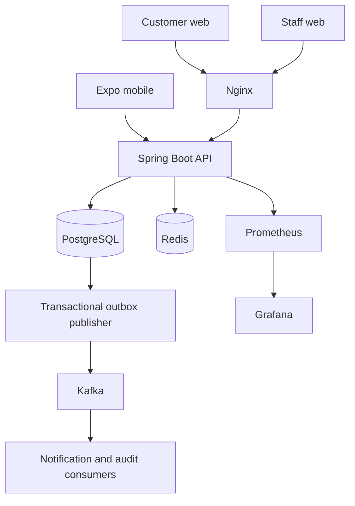

# Architecture

## Boundaries

Start with a modular monolith: authentication, users, accounts, ledger, transactions, beneficiaries, scheduled transfers, fraud, notifications, audit, and administration. Controllers validate requests and delegate to services. APIs return explicit response contracts rather than JPA entities.

PostgreSQL is the source of truth. Redis holds temporary security state and counters. Kafka transports committed events; it is never the authority for balances.

## Financial invariants

- Store amounts as exact decimal values with two fractional digits.
- Every completed transaction has equal journal debits and credits in one currency.
- Derive customer balances from journal entries, never from an independently mutable balance field.
- Lock affected accounts in a deterministic order before checking available funds and posting.
- Scope idempotency keys to the authenticated actor and bind them to request content.
- Commit the journal, transaction, and outbox event atomically.
- Held or rejected transactions do not move money.

## Trust boundaries

Backend role and ownership checks apply on every protected resource. Mobile biometrics unlock a device session and do not authorize backend actions. The staff app uses the same API with separately enforced staff roles.
