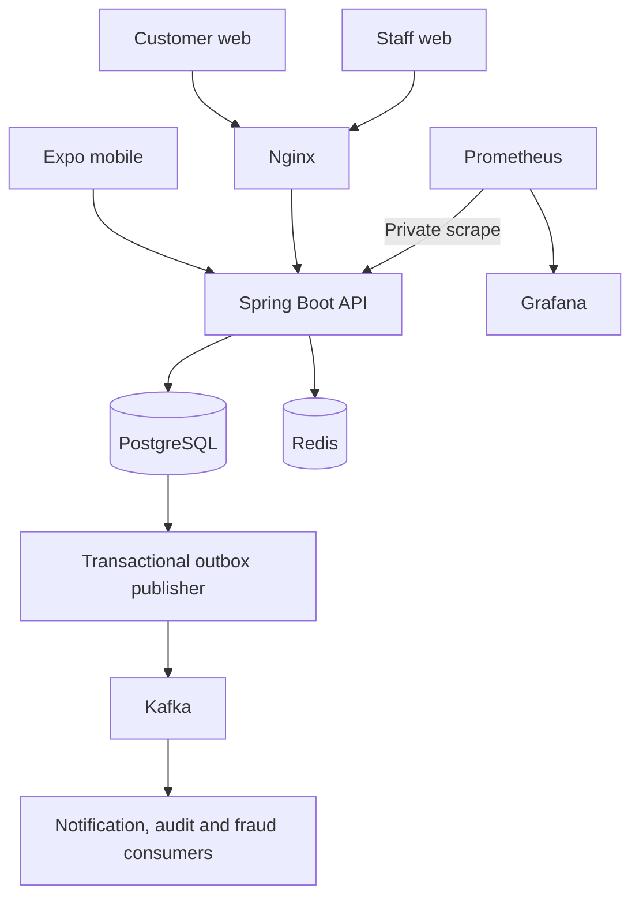

# Architecture



## Boundaries

Start with a modular monolith: authentication, users, accounts, ledger, transactions, beneficiaries, scheduled transfers, fraud, notifications, audit, and administration. Controllers validate requests and delegate to services. APIs return explicit response contracts rather than JPA entities.

PostgreSQL is the source of truth. Redis holds temporary security state and counters. Kafka transports committed events; it is never the authority for balances.

The [database model](database.md) shows durable relationships. The [ledger guide](ledger.md) explains posting and locks; [events and risk](events-and-risk.md) describes delivery guarantees and investigation decisions. Browser clients share UI/session code; native clients share API contracts and maintain their own secure device session. Both use one owned-resource API, with explicit staff endpoints for privileged access.

```mermaid
sequenceDiagram
  participant C as Customer
  participant A as API
  participant D as PostgreSQL
  participant K as Kafka
  participant N as Notification consumer
  C->>A: Submit intent with idempotency key
  A->>D: Lock actor/accounts; validate funds and policy
  alt High risk
    A->>D: Save FLAGGED intent, review and outbox; no journal
  else Allowed
    A->>D: Save completed intent, balanced journal, audit and outbox
  end
  D-->>A: Commit
  A-->>C: Receipt status
  A->>K: Publish committed outbox envelope
  K->>N: Deliver at least once
  N->>D: Claim event and create notification atomically
```

## Financial invariants

- Store amounts as exact decimal values with two fractional digits.
- Every completed transaction has equal journal debits and credits in one currency.
- Derive customer balances from journal entries, never from an independently mutable balance field.
- Lock affected accounts in a deterministic order before checking available funds and posting.
- Scope idempotency keys to the authenticated actor and bind them to request content.
- Commit the journal, transaction, and outbox event atomically.
- Held or rejected transactions do not move money.

## Trust boundaries

Backend role and ownership checks apply on every protected resource. Mobile biometrics unlock a device session and do not authorize backend actions. The staff app uses the same API with separately enforced staff roles.
