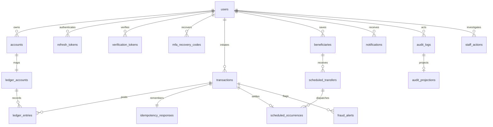

# Database model

Flyway migrations V1–V10 define the complete PostgreSQL schema. JPA validates identity mappings; financial services use explicit SQL and the same transaction manager/data source.

`transactions.source_account` and `destination_account` point to customer accounts where applicable; simulated cash is a separate internal ledger account. A normal customer balance is credits minus debits. `ledger_entries` and completed transactions are immutable. Deferred PostgreSQL constraints reject unbalanced or incomplete journals at commit, and held/failed transactions cannot retain entries. Customer account uniqueness, account number uniqueness and scoped idempotency also have database constraints.

`outbox_events` stores committed envelopes and publication retry state. `consumed_events` uses `(consumer,event_id)` uniqueness for independent consumer claims. `mail_queue` contains encrypted security messages and delivery retry state. These are delivery records, not balance inputs. `transaction_limits` and `fraud_rules` hold validated policies; `user_devices` holds hashed device hints. `platform_metadata` identifies simulator mode.

UTC `timestamptz` values preserve instants. Daily financial limits and statement periods use Africa/Lusaka. Monetary columns are `NUMERIC(18,2)`; APIs serialize them as decimal strings so JavaScript cannot round cents. Histories paginate by time with stable IDs, and ownership predicates apply before pagination. Do not expose raw identity entities or query results containing credential columns.
