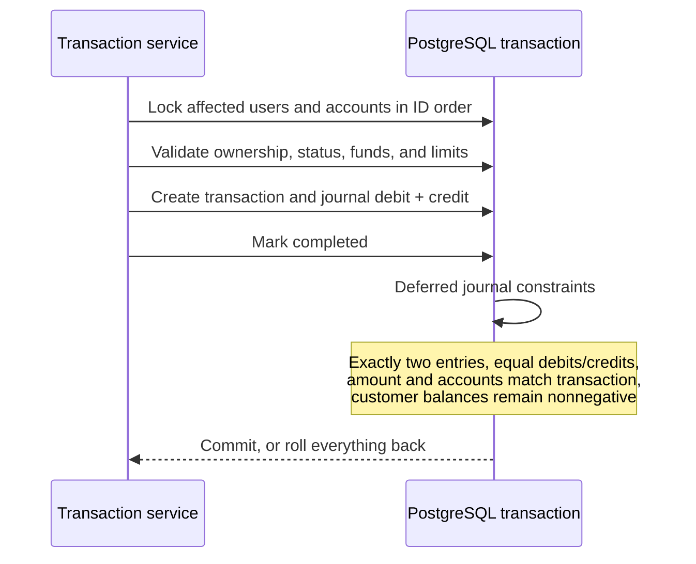

# Double-entry journal

Customer accounts are liabilities: credits increase their displayed balance and debits reduce it. Simulated deposits debit the internal `SIMULATED_CASH` ledger account and credit the customer. Withdrawals reverse that flow. Internal transfers debit the sender and credit the recipient.

There is no mutable customer balance column. `account_balances` derives exact `NUMERIC(18,2)` balances from journal entries. Java uses `BigDecimal`; API amounts are decimal strings. The shared formatter preserves cents without converting money to JavaScript floating-point values.

PostgreSQL [deferred constraint triggers](https://www.postgresql.org/docs/17/sql-createtrigger.html) run at transaction commit, after both sides have been inserted. They also reject journal entries attached to non-completed transactions. Ledger entries cannot be updated, deleted, or truncated through ordinary SQL, and completed transaction history cannot be altered. These controls do not protect against a database superuser deliberately removing constraints; production operation requires separate migration and runtime database roles.

The posting service requires an existing transaction boundary and locks ledger rows in stable order. The financial operation service owns customer authorization, bank-account locks, available-funds checks, and idempotency.
